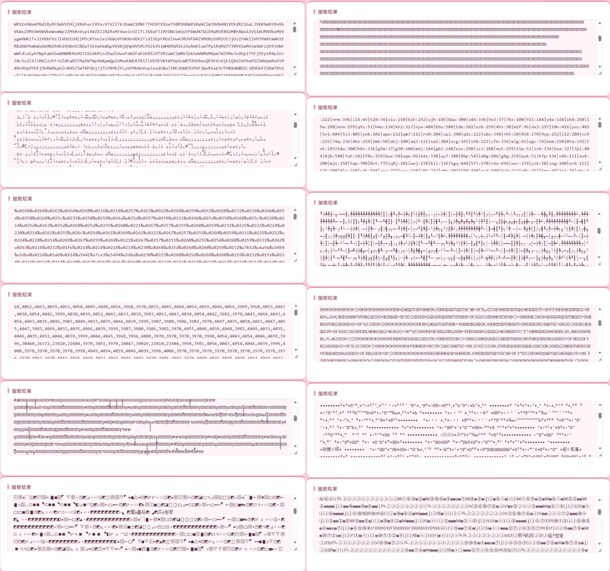

# html-encrypt 

HTML / JS 加密工具，双版本提供 10 种加密算法，中文输入加密后可在浏览器中完整还原。



## 目录结构

```
html-encrypt/
├── 前端版/                纯 HTML+JS，无需服务器，双击即用
│   ├── index.html         加密界面（10 种算法，加密全在浏览器本地完成）
│   ├── css/hxjmmw.css     样式
│   └── js/hxjmmw.js       加密逻辑（无 PHP 依赖）
├── 后端版/                PHP 版（需要 PHP 环境），界面与引擎放在一起
│   ├── index.php          PHP 版加密界面（10 种算法，POST 调后端引擎）
│   ├── crypto_engine.php  加密引擎（接收 POST，返回 JSON 结果）
│   └── 启动后端版.bat     一键启动（双击 → 起服务 → 自动开浏览器）
├── 使用说明.txt           详细使用说明
└── 效果图.jpg             加密效果展示
```

## 快速开始

**前端版**（零依赖）：

```bash
# 直接双击打开
前端版/index.html
```

**后端版**（需要 PHP）：

```bash
# 本地运行：把 PHP 便携版解压到 后端版/php/ 后双击
后端版/启动后端版.bat
# 或手动启动
cd 后端版
php -S 127.0.0.1:8899 -t .
# 访问 http://127.0.0.1:8899/index.php
```

> PHP 便携版下载：https://windows.php.net/download （Windows x64 Non-Thread Safe 即可）
> 线上部署：把 `index.php` 和 `crypto_engine.php` 放到同一目录即可。

## 加密算法

| 算法 | 说明 |
|---|---|
| 嵌套加密 | 多层 Base64 嵌套 + 反转 |
| 位移加密 | 字符位移 + 强度因子 |
| 幻影 Unicode | Unicode 编码 + 幻影偏移 |
| 逆熵 Base64 | 逆熵 Base64 循环编码 |
| 动态异或（乱码） | 动态异或矩阵 · 乱码版 |
| 动态异或（数字） | 动态异或矩阵 · 纯数字版 |
| 维度加密 | 多维校验 + 噪声注入 |
| 叠加加密 | 四种算法叠加 |
| AAA JS | 经典 eval 执行 |
| AAA HTML | 经典 document.write |

## 功能特性

- 10 种加密算法，加密强度 1-50 可调
- 加密结果实时预览（iframe 渲染还原效果）
- 一键导出加密 HTML / 复制代码
- 支持 .html / .js / .txt 文件加载
- 加密时自动保存未加密源码到 `out/` 文件夹（后端版）
- 手机端自适应，粉色主题

## 验证

两版均已完成端到端验证：中文输入加密后，产物在浏览器执行可完整还原。

## 联系

 QQ：474116782
